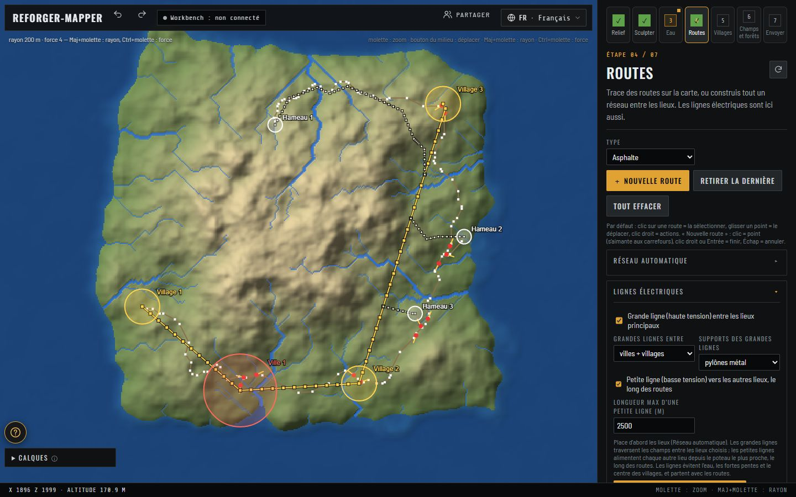
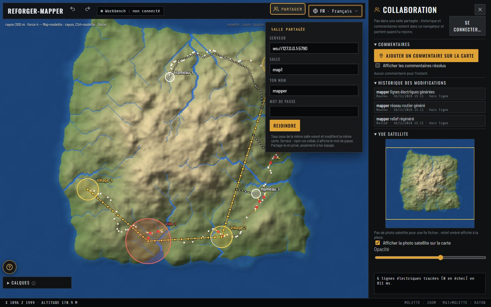
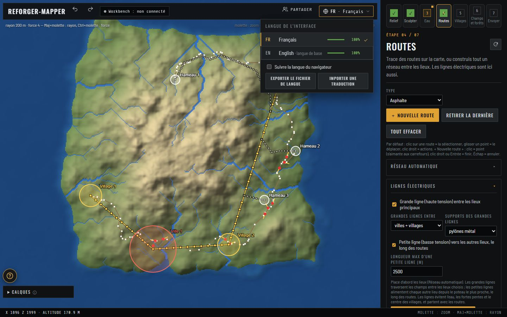

# Reforger Mapper

[English](README.md) · **Français**

> Esquisse une carte Arma Reforger dans ton navigateur en 7 étapes guidées — relief, eau, routes, villages, champs et forêts — puis envoie-la au Workbench Enfusion en un clic.

Outil de fan non officiel, en cours de développement (Vite + TypeScript), licence MIT, uniquement des assets vanilla.

**Il ne remplace pas le Workbench.** C'est dans le World Editor qu'une carte se finit (détails, éclairage, gameplay). Reforger Mapper est une couche de préparation et de travail d'équipe : poser vite les grandes lignes, laisser les générateurs faire le remplissage répétitif, préparer la carte à plusieurs, et faire des allers-retours avec un monde en cours — le Workbench reste la référence.

## Fonctions

- 🧭 **Parcours guidé en 7 étapes** avec Suivant / Précédent ; chaque étape indique si elle est faite (✓ vert), à refaire après un changement (ambre) ou à faire (gris). Les options sont repliées sous « Réglages avancés ».
- 🏝️ **Relief** : île procédurale, **lieu réel** (Copernicus, IGN LiDAR, GeoTIFF, OpenStreetMap…) ou monde ouvert dans le Workbench.
- ⛰️ **Pinceau de sculpture**, 🌊 **rivières et lacs** (tracés ou trouvés par une simulation de pluie), 🌉 ponts.
- 🛣️ **Routes** : à la main ou réseau complet entre les lieux, panneaux et mobilier, **⚡ lignes électriques** (pylônes haute tension entre les lieux principaux, poteaux basse tension le long des routes).
- 🏘️ **Villages** à partir de parcelles maison + jardin capturées sur les cartes vanilla, 🌾 **champs et forêts**.
- 📤 **Tout envoyer** au Workbench en un clic (formes, générateurs, prefabs vanilla sur leurs calques), avec rapport envoyé / construit.
- 👥 **Onglet Collaboration** : salons partagés, curseurs en direct, **historique** (qui a changé quoi), **commentaires** épinglés sur la carte, **mini-carte satellite / relief ombré**.
- ❓ **Bulle d'aide**, **visite guidée** à la première visite, FAQ et glossaire.
- 🌐 **Langues** : anglais et français intégrés ; ajoute la tienne avec un fichier JSON.
- 🎨 Thème **MILSPEC** : fond encre, accents ambre, coordonnées X / Z / altitude du curseur dans la barre d'état.

| Accueil | Aide |
|---|---|
|  |  |
| **Collaboration** | **Choix de la langue** |
|  |  |

## Démarrage rapide (sans coder)

1. Installe [Node.js](https://nodejs.org) (LTS). Télécharge ce dépôt (bouton vert **Code** → Download ZIP) et décompresse-le.
2. Ouvre un terminal dans le dossier, tape `npm install` puis `npm run dev`. Ouvre l'adresse affichée (http://localhost:5173).
3. Sur l'écran d'accueil choisis **Nouvelle île** (conseillé), **Lieu réel**, **Rejoindre un salon** ou **Ouvrir un fichier…** — puis suis les étapes.

Tout est enregistré dans le navigateur. **Enregistrer…** / **Télécharger le fichier projet** en garde une copie sur le disque.

## Les 7 étapes

| # | Étape | Ce que tu fais |
|---|---|---|
| 1 | **Relief** | Générer une île, ou importer un lieu réel ou une heightmap. |
| 2 | **Sculpter** | Modeler le sol : monter, creuser, aplanir, lisser, peindre la mer. |
| 3 | **Eau** | Tracer rivières et lacs, ou laisser la simulation de pluie les trouver. |
| 4 | **Routes** | Tracer des routes, ou un réseau complet entre les lieux. Les lignes électriques sont ici. |
| 5 | **Villages** | Remplir les lieux le long des routes : maisons, ruelles, places. |
| 6 | **Champs et forêts** | Marquer une zone à découper en champs et haies, puis forêts et zones. |
| 7 | **Envoyer** | Vérifier la carte, puis tout envoyer au Workbench. |

Souris et clavier : molette = zoom, bouton du milieu = déplacer, clic droit = actions, Maj+molette / Ctrl+molette = rayon / force du pinceau, Ctrl+Z / Ctrl+Y = annuler / rétablir, Échap = annuler l'outil, touches 1–9 = outils de sculpture. La bulle **?** (en bas à gauche) rouvre l'aide et la visite.

## Connecter le Workbench

Seulement utile à l'étape 7 — tout se dessine sans. L'indicateur en haut (**Workbench : non connecté / connecté**) montre l'état ; clique dessus pour ces étapes :

1. **Installer l'addon (une fois)** : copier `workbench/Mapgenerator/` dans `Documents/My Games/ArmaReforgerWorkbench/addons/`, puis l'ajouter dans le Workbench.
2. **Activer la NET API** : Workbench > Options, NET API activée (port **5775**).
3. Ouvrir le Workbench avec l'addon Mapgenerator et ton monde chargés.
4. **Lancer le relais** : double-clic sur `start-bridge.bat` (Windows), ou `npm run bridge` (port **5780**). Laisser sa fenêtre ouverte.
5. Cliquer **Réessayer** : l'indicateur passe au vert.

Aucun outil d'IA ni serveur MCP n'est nécessaire. Les plugins sont dans le menu **MapGen** du World Editor (`Apply project`, `Apply heightmap`, `Entity budget`, `Capture templates`, etc. — liste complète dans le [README anglais](README.md#connecting-the-workbench)). À l'envoi, `profile/MapGen/report.txt` compare ce qui a été envoyé (`sent.txt`) et construit (`built.txt`).

**Importer le monde ouvert** : relief, routes, rivières et lacs deviennent modifiables ; bâtiments et panneaux restent verrouillés ; les objets remplacés ne sont supprimés que par l'envoi qui les reconstruit (pas de doublons).

## Collaboration

1. Une personne lance `npm run collab` (port **5790**) ; il affiche un mot de passe.
2. Chacun clique **Partager** (ou **Rejoindre un salon** à l'accueil), entre l'adresse du serveur, un nom de salon et le mot de passe.
3. La carte se synchronise, les curseurs de chacun s'affichent. L'onglet Collaboration contient :
   - **Commentaires** : épingle numérotée sur la carte, réponses, résolution.
   - **Historique** : qui a fait quoi, à quelle étape, quand — un clic centre la carte.
   - **Vue satellite** : mini-carte (photo satellite pour un lieu réel, relief ombré sinon) avec opacité.

Historique, commentaires et dernière carte sont gardés dans `collab/data/<salon>.jsonl` / `.project.json` et reviennent après un redémarrage. Rien n'est envoyé sans le bon mot de passe ; le serveur n'écoute que sa propre machine sauf si `MAPGEN_COLLAB_HOST` est défini. Partage en réseau local ou VPN privé (ex. Tailscale), jamais ouvert sur Internet ; le dernier changement gagne.

## Langues et traduction

Bouton de langue (en haut à droite) : choisis une langue (avec son % de traduction) ou coche « Suivre la langue du navigateur ». Flèches + Entrée, Échap ferme.

**Ajouter une langue** — sans coder :
1. Dans le menu de langue, **Exporter le fichier de langue** : un JSON avec toutes les clés de texte.
2. Traduis les valeurs (garde les clés et les `{variables}` telles quelles).
3. **Importer une traduction** : elle apparaît comme nouvelle langue ; les textes manquants restent en anglais.

Pour l'intégrer à l'outil pour tous, ajoute la table dans `src/i18n.ts` et ouvre une pull request (voir [CONTRIBUTING.md](CONTRIBUTING.md)).

## Développement

| Commande | Rôle |
|---|---|
| `npm install` | Installer les dépendances |
| `npm run dev` | Site avec rechargement à chaud (http://localhost:5173) |
| `npm run build` | Vérif TypeScript (`tsc`) et build dans `dist/` |
| `npm run preview` | Servir le site construit |
| `npm run bridge` | Relais local vers le Workbench (port 5780) — ou `start-bridge.bat` |
| `npm run collab` | Serveur de collaboration (port 5790) |

Cahier de recette : [docs/RECETTE.md](docs/RECETTE.md). Historique des versions : [CHANGELOG.md](CHANGELOG.md). Lieu réel, problèmes connus et index complet de `docs/` : voir le [README anglais](README.md#start-from-a-real-place).

## Crédits et licence

Ce projet s'appuie sur le travail de nombreuses personnes (BARNMAP, Map-generator de giorbev, mapgen4, AgriFieldGenerator, geotiff.js…) — détail complet dans [CREDITS.md](CREDITS.md) et le [README anglais](README.md#thanks-credits-and-sources).

- **ARTE** (plugin QGIS, © 2026 Icebird, licence **MIT**) : table des largeurs de routes OSM, exclusion ponts/tunnels, lit de route au-dessus de l'eau et remplissage des trous NoData portés en TypeScript (voir [CREDITS.md](CREDITS.md), [docs/ARTE_STUDY.md](docs/ARTE_STUDY.md)).
- Données : OpenStreetMap (ODbL), Copernicus DEM (attribution), ESA WorldCover (CC BY 4.0), IGN LiDAR HD (Licence Ouverte Etalab 2.0).

Code sous licence [MIT](LICENSE). *Arma Reforger* et *Enfusion* sont des marques de **Bohemia Interactive**. Reforger Mapper est un **outil de fan non officiel**, ni affilié ni approuvé par Bohemia Interactive.
