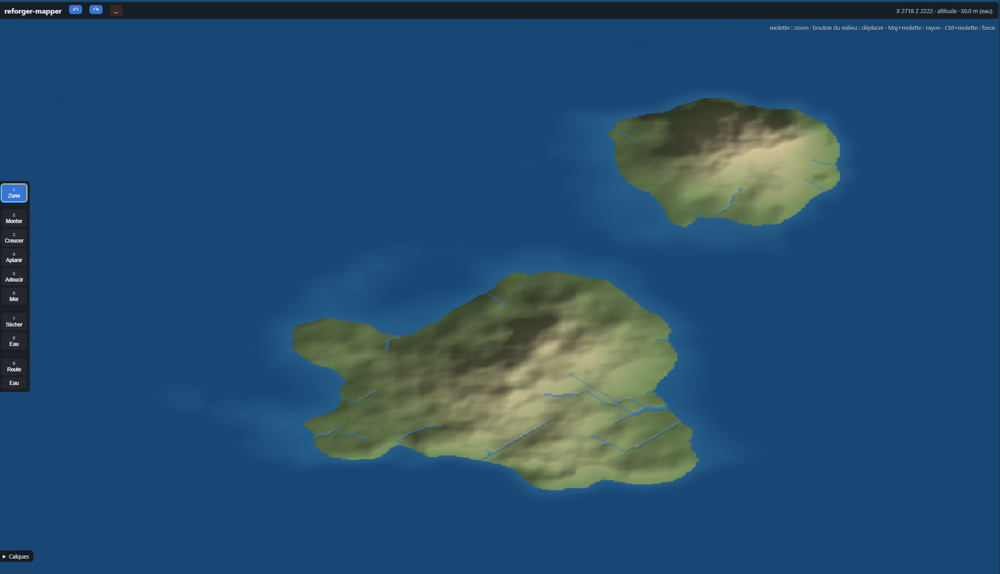
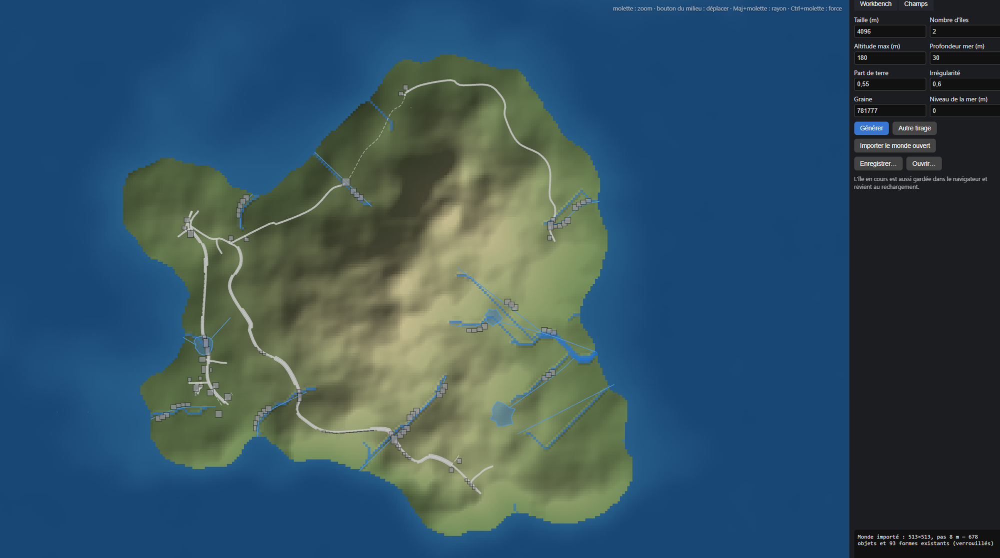
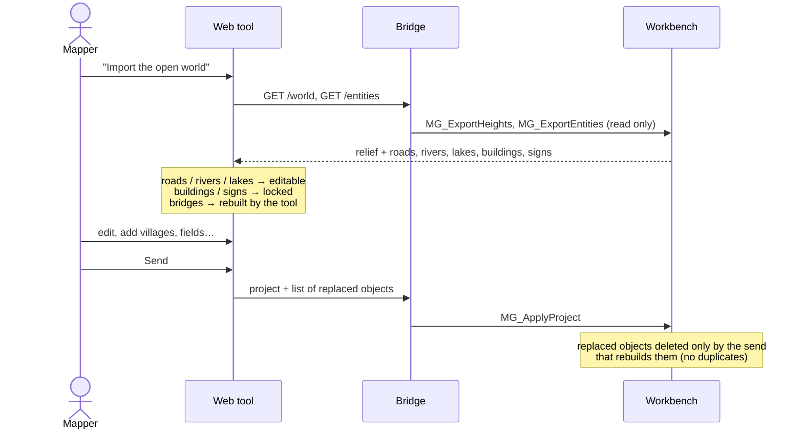
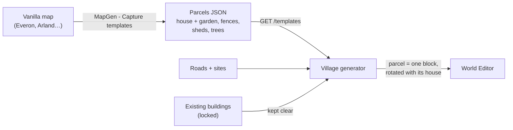

# Reforger Mapper

> Reforger Mapper is an unofficial, work-in-progress web tool (Vite + TypeScript) to quickly design Arma Reforger terrains: generate an island, sculpt the heightmap, paint surface masks, lay out roads, rivers, lakes and bridges, then send everything to the Enfusion Workbench through a small local bridge and a Workbench plugin (`MapGen` menu). Vanilla assets only. MIT licensed. The UI is in English and French (toggle in the top bar); the documentation is in English.

Web tool to map quickly for **Arma Reforger** (Enfusion engine) and auto-fill a map with vanilla assets, then send it to the Workbench World Editor.

### What it is — and what it is not

**It does not replace the Workbench.** The World Editor is a great mapping tool and the place where a map is really finished: detailing, lighting, gameplay, polish. Reforger Mapper does not try to redo it.

**It is a planning and teamwork layer on top of it**, to:

- 🎯 **Focus the work**: rough out the big picture fast (relief, road network, rivers, lakes, where villages and fields go) and let generators do the repetitive filling, so mappers spend their Workbench time on what matters.
- 👥 **Build a map with several people**: a shared, lightweight view of the map that anyone can open, draw on and discuss, without each person needing the whole project in the Workbench. Run `npm run collab` on one machine (port **5790**): it prints a password. Each mapper clicks 👥, enters the server address, the room name and that password: the map syncs and everyone's cursor shows. Nothing is sent before the right password; the server only listens on its own machine unless `MAPGEN_COLLAB_HOST` is set; rooms are erased when the last mapper leaves. *(Share over a LAN or a private VPN such as Tailscale, never openly on the internet; the last change wins. Online site: on the roadmap.)*
- 🔁 **Go back and forth**: import a world in progress from the Workbench, change the plan, send it back — the Workbench stays the source of truth.

  
  

Left: a generated island with its simulated rivers. Right: a world in progress imported from the Workbench, its roads, rivers, lakes and buildings ready to edit.

## At a glance

```mermaid
flowchart LR
    subgraph WEB["🌐 Web tool (browser)"]
        direction TB
        T[Terrain<br/>generate · sculpt]
        R[Roads<br/>network · signs · barriers]
        W[Water<br/>rivers · lakes · bridges]
        V[Villages<br/>captured parcels]
        F[Fields<br/>Voronoi plots]
    end
    B["🔌 Local bridge<br/>Node · port 5780"]
    subgraph WB["🛠️ Enfusion Workbench"]
        direction TB
        P["MapGen plugin<br/>NET API · port 5775"]
        WE[World Editor<br/>shapes · generators · prefabs]
    end
    WEB -- "send project (JSON)" --> B
    B -- "MG_ApplyProject" --> P
    P --> WE
    WE -. "import: relief, roads,<br/>rivers, lakes, buildings" .-> P
    P -. "MG_ExportHeights<br/>MG_ExportEntities" .-> B
    B -. "GET /world · /entities" .-> WEB
```

## Features

| | Feature | Status |
|---|---|---|
| 🏝️ | **Island generation**: procedural heightmap (noise, island shape), heightmap export | ✅ |
| ⛰️ | **Sculpt**: interactive terrain brush (approach inspired by mapgen4) | ✅ |
| 🎨 | **Surfaces and masks**: surface masks from altitude, slope… + satellite image | ✅ |
| 🛣️ | **Roads**: drawing, road network (graph), furniture and signs along roads | ✅ |
| 🌊 | **Water**: rivers (flow accumulation), lakes, banks | ⚠️ placement not right yet |
| 🌉 | **Bridges** at road / river crossings | ⚠️ placement to fix |
| ⚡ | **Power lines**: pylons and poles linking villages | ⬛ to do |
| 🏘️ | **Villages** built from house + garden parcels captured on the vanilla maps | 🧪 testing |
| 🌾 | **Countryside**: farm plots (Voronoi, inspired by AgriFieldGenerator) | ✅ |
| 📥 | **Import a world in progress**: relief, roads, rivers, lakes become editable; buildings and signs stay locked | 🧪 testing |
| 📊 | **Entity budget**: entities per cell vs platform limit, terrain occlusion, duplicates and buried objects | ✅ limits provisional |
| 📤 | **Send to the Workbench**: shapes, generators and vanilla prefabs, on their own layers | ✅ |

### Round trip with a world in progress

### Village generation from captured parcels

Main modules: `src/modules/` (`island`, `sculpt`, `roads`, `network`, `hydro`, `water`, `campaign`), `src/terrain.ts`, `src/project.ts`, `src/bridge.ts`.

## How it works

1. **Site**: `npm install` then `npm run dev` → http://localhost:5173
2. **Local bridge**: `npm run bridge` (Node, port **5780**), which links the site to the Workbench.
3. **Workbench plugin**: copy `workbench/Mapgenerator/` as an addon into
   `Documents/My Games/ArmaReforgerWorkbench/addons/`, then add it in the Workbench.
4. **Enable the Workbench NET API**: Workbench > Options, NET API enabled (port **5775**). The bridge talks to the
   plugin's own handlers (`MG_*`); nothing else is needed (no AI tool, no MCP server).

   The plugins appear in the World Editor **MapGen** menu:
   - `MapGen - Apply project`: applies the project sent by the site
   - `MapGen - Apply heightmap`
   - `MapGen - Labels`: debug labels
   - `MapGen - Entity budget`: entity count per cell, terrain occlusion, suspects (duplicates, buried objects)
   - `MapGen - Capture templates`: captures building parcels (house + garden) from any world, for the village generator
   - `MapGen - Measure prefabs`
   - `MapGen - Regenerate MG_ shapes`
   - `MapGen - Register surfaces`
   - `MapGen - Stamp calibration`, `MapGen - Terrain probe`, `MapGen - Create test shapes`,
     `MapGen - Terrain write test` / `test 2` (diagnostic tools)

## Documentation (`docs/`)

| File | Content |
|---|---|
| [ARCHITECTURE.md](docs/ARCHITECTURE.md) | Architecture: a single tool, three layers, modules sharing one project |
| [ROADMAP.md](docs/ROADMAP.md) | Roadmap and tech stack |
| [RESEARCH.md](docs/RESEARCH.md) | Research file (BARNMAP, Map-generator, mapgen4, AgriFieldGenerator…) |
| [STATE_OF_ART.md](docs/STATE_OF_ART.md) | State of the art of terrain generation / auto-fill (engines, tools, data, libs) |
| [CITIES.md](docs/CITIES.md) | Village and town generation: state of the art and proposed pipeline |
| [GENERATORS.md](docs/GENERATORS.md) | List of vanilla World Editor generator prefabs (`Prefabs/WEGenerators/`) |
| [ENFUSION_FORMATS.md](docs/ENFUSION_FORMATS.md) | Enfusion formats and API (verified / assumed) |
| [WIKI_TERRAIN.md](docs/WIKI_TERRAIN.md) | Summary of the Bohemia wiki on Reforger terrain creation |
| [WORKSHOP_TERRAIN_MODS.md](docs/WORKSHOP_TERRAIN_MODS.md) | Study of Workshop terrain tooling mods |
| [FINDINGS.md](docs/FINDINGS.md) | Findings and pitfalls (Workbench script, measured prefabs, water, tooling) and remaining work |
| [BENCHMARK_GIORBEV.md](docs/BENCHMARK_GIORBEV.md) | Analysis of giorbev's benchmark tool |
| [FF_ET_SKILLS.md](docs/FF_ET_SKILLS.md) | Notes reused from Reforger / Freedom Fighters modding |

## Status and roadmap

**Work in progress** — the goal is a real mapping assistant next to the Workbench (not a replacement), and later an online space where several mappers plan the same map together.

| Phase | Goal | Status |
|---|---|---|
| **1. Base** | Terrain, sculpting, roads, rivers, lakes, bridges, fields, send to the Workbench | ✅ done |
| **2. Work on real maps** | Import a world in progress, edit it, send it back without duplicates | ✅ done, being tested |
| **3. Villages** | Villages built from parcels: captured on the vanilla maps or made in the parcel library (📦), shared by the community | 🟡 in progress |
| **4. Fix what exists** | Bridge placement, rivers and lakes sitting right in the relief, better banks | 🟡 in progress |
| **5. Fill the map** | Rocks on slopes, automatic forests, paths, field zones, power lines | ⬜ to do |
| **6. Complete import** | Ground surfaces of an existing world, generator settings (road width…) | ⬜ to do |
| **7. Together** | Shared rooms ✅ (first version) → online site, accounts, SHP / CSV export, real-time merging | 🟡 started |
| **8. Real-world import** | Start from a real place: elevation (DEM, LiDAR), roads, water, forests, fields and land cover, then edit it like a base mesh | ✅ first full version (elevation, LiDAR GeoTIFF, OpenStreetMap roads / water / forests / fields / buildings, forest and field ground, tracing image), land cover, satellite tracing — on par with BARNMAP |

What changed and when: [CHANGELOG.md](CHANGELOG.md).

### Start from a real place

The idea: load a real area as a **starting shape**, then reshape it with the brush, the generators and the
parcel library, like a primitive mesh in 3D modelling.

**How (Island tab → 🌍 Real place…):**
1. Open an elevation file — GeoTIFF (Copernicus, national LiDAR terrain models…), ESRI ASCII grid `.asc`
   (e.g. IGN LiDAR HD / RGE ALTI), SRTM `.hgt` or a greyscale PNG (8 or 16 bits) — **or** type a latitude and a
   longitude to download the Copernicus DEM 30 m tile (through the bridge if the browser is refused).
2. Pick the area on the shaded preview: drag to move, wheel to resize, Shift + wheel to turn; the white edge
   becomes the north of the map. Set the grid (513 / 1025 / 2049), the vertical scale and the sea level.
3. Tick the OpenStreetMap features to bring (downloaded from the public Overpass API, or from an Overpass JSON
   file), then **Build the terrain**.
4. Sculpt, fix and generate as usual. Forests are sent with **Send forests** (Fields tab); right-click an
   OpenStreetMap field area to use it as the field zone.

The table shows what is done (✅) and what is still planned (⬜).

| Data | Source (open data) | Becomes in the tool |
|---|---|---|
| ✅ **Elevation** | 16-bit PNG / GeoTIFF heightmap of your own; downloaded for you: Copernicus DEM GLO-30 (30 m, world, tiles joined), Terrarium tiles (world), IGN RGE ALTI (1-5 m, France) and IGN LiDAR HD (1 m, France, where flown) | Heightmap: pick the area, rotate, crop, rescale to the Reforger terrain size and grid, choose the sea level; then sculpt on top |
| ✅ **Roads, tracks, paths** | OpenStreetMap | Road shapes with the matching road generator (asphalt, dirt, trail…), pieces of the same road joined |
| ✅ **Rivers, lakes, sea** | OpenStreetMap, Copernicus water layers | River and lake shapes, laid on the relief; the sea is wherever the real relief is at or below 0 m |
| ✅ **Forests** (OSM, WorldCover), **tree height** (LiDAR) | OpenStreetMap woods, ESA WorldCover / CORINE land cover; LiDAR canopy height (surface minus terrain) | Forest areas sent as vanilla forest generators: leaf type from the OSM tag, tree height (young / normal / mature) from a LiDAR canopy height file, fetched with IGN LiDAR HD, or set by hand (right-click). Forests can also be outlined from ESA WorldCover and welded with the OSM ones. Reforger has no tree-height setting, so the height only picks the generator |
| ✅ **Fields, places, ground surfaces** | OpenStreetMap land use and places, ESA WorldCover 10 m (through the bridge) | Field areas (usable as field zones), village sites from towns / villages / hamlets; ground surfaces from land cover: forest floor, crop field, heath (shrubs), concrete (built-up), dirt (bare ground) |
| ✅ **Buildings** | OpenStreetMap footprints | Each footprint replaced by the closest-sized vanilla building, turned to match (big blocks with no match are skipped) |
| ✅ **Satellite / ortho photo** | Esri World Imagery (fetched for the area), or imagery of your own | Tracing image in the Layers panel, stretched over the terrain with an opacity slider (not sent to the game, not saved) |

**Adapted, not copied** (option ticked by default): woods closer than 25 m are welded into one forest and small isolated woods dropped, short minor road pieces dropped, dense town centres thinned (3 buildings per 40 m square at most, 2500 in all) — for gameplay and frame rate. Untick it for a faithful copy.

**Picking the place**: search a place by name (OpenStreetMap Nominatim) or type latitude / longitude, then Download: every Copernicus tile under the area is fetched and joined (no hole on tile borders). Size buttons 4 / 8 / 16 / 32 km (×1024 m, like BARNMAP), 4 favourite areas (click to load, Shift+click to replace), a satellite background under the picker, and a warning when the relief goes over the 2046 m the Reforger terrain can hold.

Limits to keep in mind: real data rarely fits the Reforger size and the entity budget as is (it will be
scaled and simplified); a 30 m DEM is smooth and needs sculpting for small details; every source has its own
licence (OpenStreetMap: ODbL, attribution and share-alike; Copernicus: attribution) — the tool writes it in the log
and keeps it in the project. A busy town can bring hundreds of roads: untick small roads and paths for a first pass.

### Known issues / not finished

- 🌉 **Bridges**: deck height, length and alignment with the road are often off; some crossings get no bridge or a misplaced one.
- 🌊 **Rivers**: the course and bed do not always sit right in the relief (water floating above or sunk under the banks); banks are still rough.
- 💧 **Lakes**: shore and water level not always matched to the terrain; lake placement needs work.
- ⚡ **Power lines**: no electric network yet (pylons, poles and wires between villages and along roads).
- 🪨 Rocks, 🌲 automatic forests, 🛤️ paths and 🌾 field zones: not generated yet.
- 🧱 Ground surfaces are not imported from an existing world (relief only).
- 📊 Entity budget limits per platform are provisional (no measured FPS data yet).

Want to help? See [CONTRIBUTING.md](CONTRIBUTING.md). Help is welcome on: bridge, river and lake placement, power lines, riverbank / lake shore generation, rocks on steep slopes, automatic forests, paths and field zones, ground surface import, and FPS bench data per platform (Xbox Series S/X, PS5, PC) to calibrate the entity budget.

- **Vanilla assets** only: no third-party content is required or redistributed.
- **No AI tool required**: the site, the bridge and the plugin are all you need.
- Sources, inspirations and licences: see [CREDITS.md](CREDITS.md).

## Thanks, credits and sources

This project stands on the work of many people — thank you to all of them. What was reused from each and the full notes: [CREDITS.md](CREDITS.md).

### Projects

| Project | Author | Licence |
|---|---|---|
| [BARNMAP (v1.48)](https://ustorie.github.io/BARNARMA/) | Barnaber / LEBARNABER | None (closed exe) |
| [Map-generator ("Map Generator Pro" v7)](https://github.com/giorbev/Map-generator) | giorbev | MIT (© 2026 Giorbev) |
| [mapgen4](https://github.com/redblobgames/mapgen4) | Amit Patel (Red Blob Games) | Apache-2.0 |
| [geotiff.js](https://github.com/geotiffjs/geotiff.js) (library, reads GeoTIFF) | geotiff.js contributors | MIT |
| [AgriFieldGenerator (v1.2.0)](https://github.com/Tanin69/AgriFieldGenerator) | Tanin69 (Didier ALAIN) | MIT (© 2024) |
| Benchmark_Tools_reforger | giorbev | None (© 2025, all rights reserved) |
| Lou's tools (`SCR_WorldEditorToolHelper.c`, `SCR_ImageHelper.c`) | Lou | not specified |
| [Azgaar Fantasy Map Generator](https://github.com/Azgaar/Fantasy-Map-Generator) | Azgaar | MIT |
| [ProbableTrain MapGenerator](https://maps.probabletrain.com/) | ProbableTrain | LGPL-3.0 (to confirm) |
| Medieval Fantasy City Generator / TownGeneratorOS | watabou | GPL-3.0 (old Haxe version) / closed |
| city-roads | anvaka | MIT |
| [Fantasy Town Generator](https://www.fantasytowngenerator.com/temporary-settlement) | — | closed |
| [FantasyGen City Map Generator](https://fantasygen.net/city-map-generator) | — | closed |
| [Simteract City Generator](https://simteract.com/projects/city-generator/) | Simteract | closed |
| [Mapimator City Roads](https://mapimator.com/tools/city-roads) | Mapimator | closed |
| Wave Function Collapse | mxgmn | MIT (unverified) |
| [ProtonScatter](https://github.com/HungryProton/scatter) | HungryProton | — |
| [PCGExtendedToolkit](https://github.com/PCGEx/PCGExtendedToolkit) | PCGEx | — |
| [Unreal PCG / Biome Core](https://dev.epicgames.com/documentation/en-us/unreal-engine/procedural-content-generation-pcg-biome-core-and-sample-plugins-overview-guide-in-unreal-engine) | Epic Games | proprietary |
| [ReforgerSatGenerator](https://github.com/granQ/ReforgerSatGenerator) | granQ | — |
| [ARTE (QGIS plugin)](https://plugins.qgis.org/plugins/ARTE/) | — | — |

### Data

| Data | Licence |
|---|---|
| OpenStreetMap / Overpass | ODbL (attribution + share-alike) |
| [ESA WorldCover 10 m](https://registry.opendata.aws/esa-worldcover-vito/) | CC BY 4.0 |
| [Copernicus DEM GLO-30 (© DLR / Airbus)](https://registry.opendata.aws/copernicus-dem/) | Copernicus licence, attribution required |
| [Mapterhorn](https://mapterhorn.com/data-access/) | Per source: https://download.mapterhorn.com/attribution.json |
| [IGN LiDAR HD (DTM)](https://www.data.gouv.fr/datasets/mnt-lidar-hd-ign-2025) | Licence Ouverte Etalab 2.0 (to confirm) |
| Mapzen / Tilezen (Terrarium), Esri World Imagery, CARTO basemap | Seen in BARNMAP |

<b>More sources</b>: games and city builders studied, papers, tools, Workshop mods, Bohemia tools

#### City builders and games studied (ideas only, CITIES.md §6)

- OpenTTD, town growth: https://github.com/OpenTTD/OpenTTD/blob/master/src/town_cmd.cpp (GPL-2.0), https://wiki.openttd.org/en/Manual/Game%20mechanics
- Micropolis (open-source SimCity): https://github.com/SimHacker/micropolis (GPL-3.0)
- Citybound: https://github.com/citybound/citybound, https://aeplay.org/citybound-devblog (AGPL-3.0)
- Cities: Skylines: https://skylines.paradoxwikis.com/Zoning, https://skylines.paradoxwikis.com/Districts
- Manor Lords: https://wiki.hoodedhorse.com/Manor_Lords/Building ; Banished
- Minecraft ("jigsaw" villages): https://minecraft.wiki/w/Village, https://minecraft.wiki/w/Jigsaw_Block
- Townscaper (Oskar Stålberg): https://www.gamedeveloper.com/design/how-townscaper-works-a-story-four-games-in-the-making

### Scientific papers

- Parish & Müller (2001), "Procedural Modeling of Cities", SIGGRAPH: street generation.
- Chen, Esch, Wonka, Müller, Zhang (2008), "Interactive Procedural Street Modeling": tensor fields.
- Vanegas et al.: lot subdivision.
- Emilien et al. (2012), "Procedural generation of villages on arbitrary terrains", The Visual Computer: https://hal.inria.fr/hal-00694525
- Zevenbergen & Thorne: terrain curvature (via Map-generator).

Published algorithms, freely reimplemented; no code copied.

### Tools and sites

- Gaea (QuadSpinner): https://quadspinner.com/Order/ (idea: erosion masks)
- World Machine: https://www.cgchannel.com/?p=122990 (idea: tiling with margins)
- World Creator: https://www.world-creator.com/en/buy.phtml
- Houdini (SideFX): https://www.sidefx.com/faq/question/houdini-engine-plugin-free-for-unity-and-unreal/
- Instant Terra, L3DT, Blender-OSM / Blosm, terrain.party
- PCG UE5.6/5.7 (80.lv): https://80.lv/articles/what-s-new-in-pcg-in-ue5-6-ue5-7
- Godot assets (https://godotengine.org/asset-library/asset/edit/14377, https://godotengine.org/asset-library/asset/edit/8541), Fab asset (https://www.fab.com/listings/013f192b-caf4-422f-b560-5166f8c6d9b8), video https://www.youtube.com/watch?v=UmUs9W4riPs: ideas

#### Libraries used

`@turf/turf` (MIT), `maplibre-gl` (BSD-3-Clause), `poisson-disk-sampling` (MIT), `simplex-noise` (MIT), Vite (MIT), TypeScript (Apache-2.0).

### Workshop mods studied

Read for ideas (excerpts of at most 10 lines quoted in the docs, no code copied). **No licence or author stated.**

- AdvancedTerrainTools (`6874E07B40C6D5E5`)
- OutsideTerrainCore (`61F0D506562D9BC9`) / Outside Terrain Tool: https://reforger.armaplatform.com/workshop/61F2B96F0D3F27D4
- TerrainAutomationTools (`684876344DA83476`)
- BARNMAP OMAHA sample map (`6A84C9A969207F9F`)
- Freedom Fighters (conventions and skills, see FF_ET_SKILLS.md)

### Data sources (DEM, OSM…)

### Bohemia Interactive tools

- Arma Reforger Tools / Enfusion Workbench, World Editor, Terrain Creation Tool: https://community.bistudio.com/wiki/Arma_Reforger:World_Editor:_Terrain_Creation_Tool
- Bohemia wiki (BIKI): https://community.bistudio.com/wiki/ (read via the offline dump shipped with enfusion-mcp)
- Terrain Builder / Terrain Processor (Arma 3): https://community.bistudio.com/wiki/Terrain_Processor:_Tutorial
- Official terrain tutorial: https://reforger.armaplatform.com/news/terrain-tutorial
- Vanilla generator prefabs (`Prefabs/WEGenerators/`) and vanilla game assets

Arma Reforger and Enfusion are trademarks of Bohemia Interactive. Unofficial fan tool.

### Other

- **enfusion-mcp**: MCP server used to explore the API, the game files and the wiki.
- Development assisted by **Claude (Anthropic)**.

## Licence and notices

Code under the [MIT](LICENSE) licence.

*Arma Reforger* and *Enfusion* are trademarks of **Bohemia Interactive**. Reforger Mapper is an **unofficial fan tool**, not affiliated with or endorsed by Bohemia Interactive.
