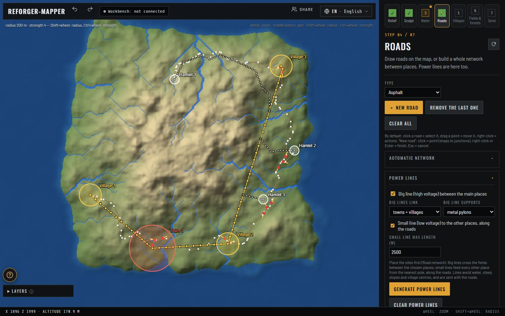
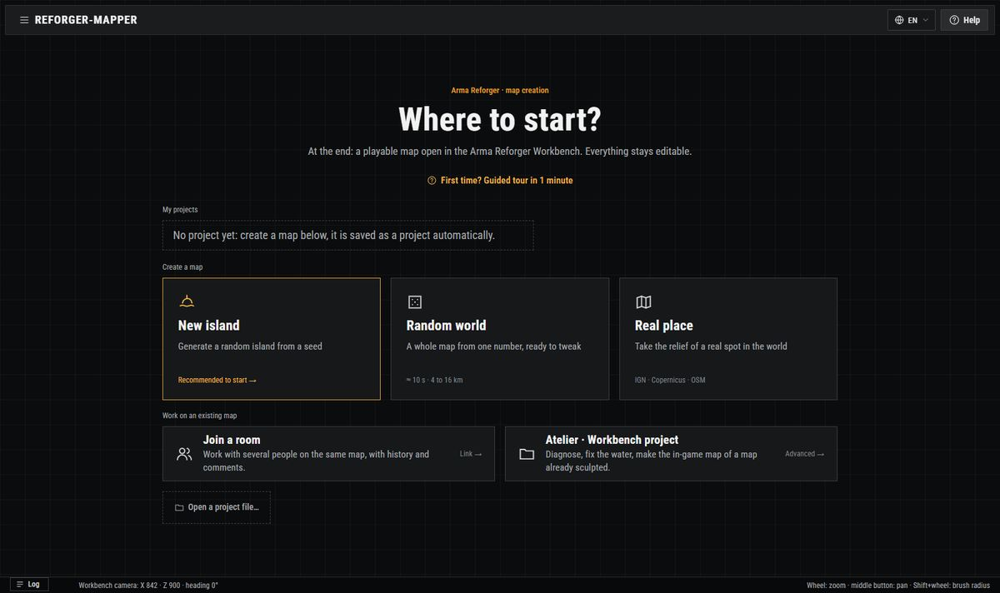
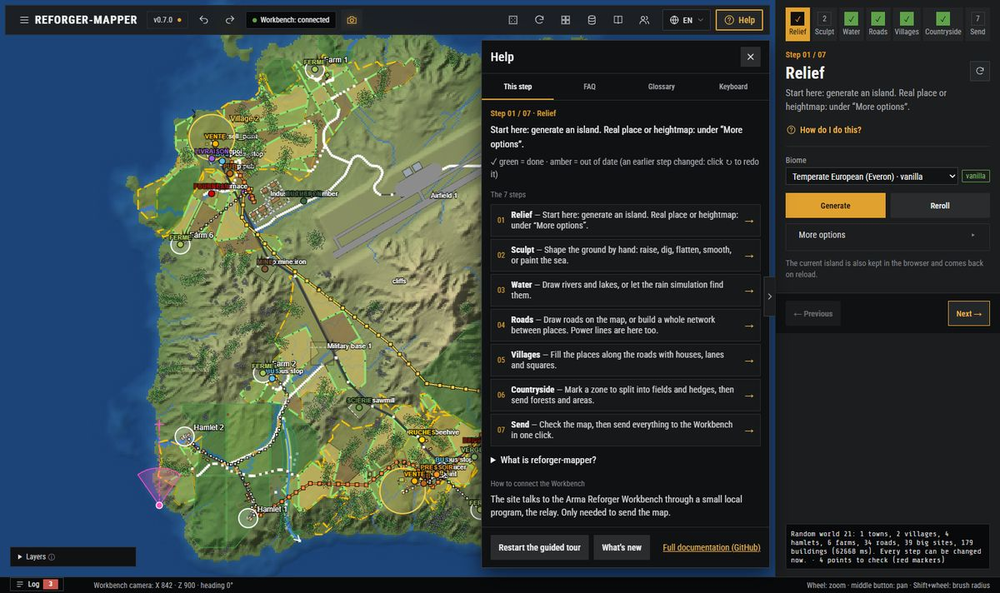
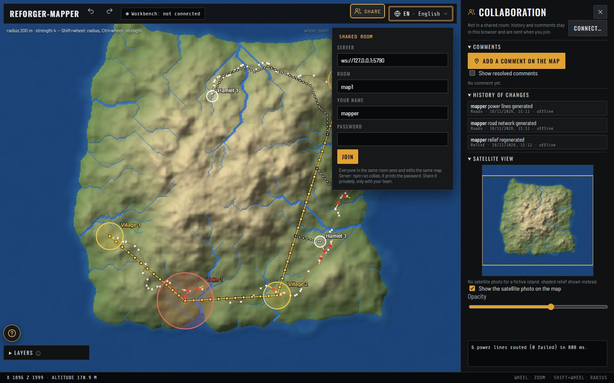
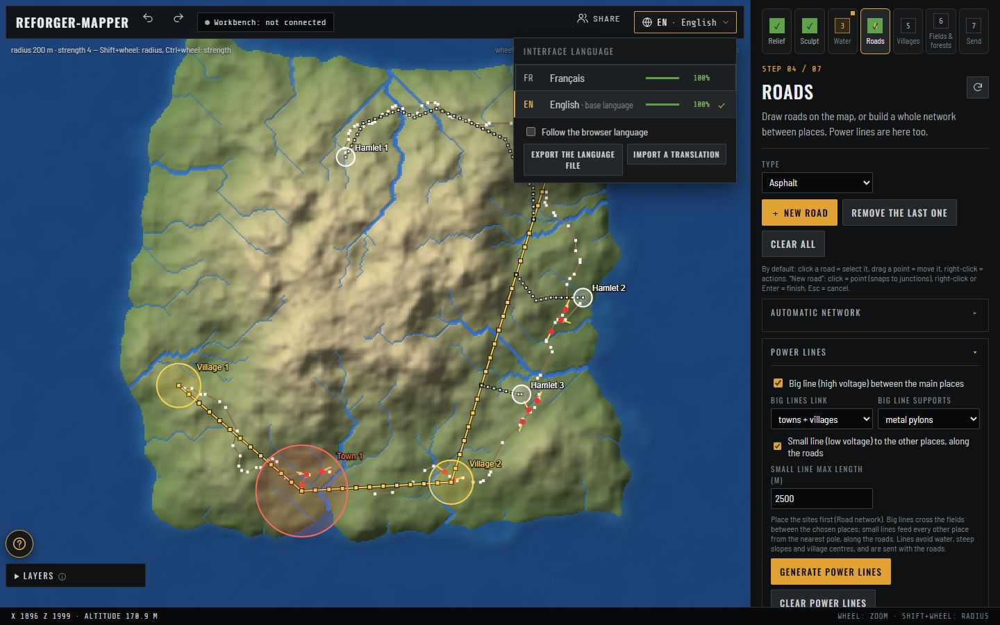

# Reforger Mapper

**English** · [Français](README.fr.md)

> Sketch an Arma Reforger map in your browser in 7 guided steps — relief, water, roads, villages, fields and forests — then send it to the Enfusion Workbench in one click.

Unofficial, work-in-progress fan tool (Vite + TypeScript), MIT licensed, vanilla assets only.

**It does not replace the Workbench.** The World Editor is where a map is really finished (detailing, lighting, gameplay). Reforger Mapper is a planning and teamwork layer on top of it: rough out the big picture fast, let generators do the repetitive filling, plan the map with several people, and go back and forth with a world in progress — the Workbench stays the source of truth.

## Features

- 🧭 **Guided path in 7 steps** with Next / Previous; each step shows if it is done (green ✓), out of date after an earlier change (amber) or still to do (grey). Optional settings are folded under "Advanced settings".
- 🏝️ **Relief**: procedural island, or a **real place** (Copernicus, IGN LiDAR, GeoTIFF, OpenStreetMap…), or the world open in the Workbench.
- ⛰️ **Sculpt** brush, 🌊 **rivers and lakes** (drawn or found by a rain simulation), 🌉 bridges.
- 🛣️ **Roads**: hand-drawn or a whole network between places, road signs and furniture, **⚡ power lines** (high-voltage pylons between the main places, low-voltage poles along roads).
- 🏘️ **Villages** from house + garden parcels captured on the vanilla maps, 🌾 **fields and forests**.
- 📤 **Send everything** to the Workbench in one click (shapes, generators, vanilla prefabs on their own layers), with a sent-vs-built report.
- 👥 **Collaboration tab**: shared rooms, live cursors, **history** of who changed what, **comments** pinned on the map, **satellite / hillshade mini-map**.
- ❓ **Help bubble**, a **guided tour** on first visit, FAQ and glossary.
- 🌐 **Languages**: English and French built in; add your own with a JSON file.
- 🎨 **MILSPEC** look: dark ink background, amber accents, cursor X / Z / altitude in the status bar.

| Welcome | Help |
|---|---|
|  |  |
| **Collaboration** | **Language selector** |
|  |  |

## Quick start (no coding needed)

1. Install [Node.js](https://nodejs.org) (LTS). Download this repository (green **Code** button → Download ZIP) and unzip it.
2. Open a terminal in the folder and type `npm install`, then `npm run dev`. Open the address it prints (http://localhost:5173).
3. On the welcome screen pick **New island** (recommended), **Real place**, **Join a room**, or **Open a file…** — then follow the steps.

Everything is saved in your browser. **Save…** / **Download the project file** keeps a copy on disk.

## The 7 steps

| # | Step | What you do |
|---|---|---|
| 1 | **Relief** | Generate an island, or import a real place or a heightmap. |
| 2 | **Sculpt** | Shape the ground by hand: raise, dig, flatten, smooth, paint the sea. |
| 3 | **Water** | Draw rivers and lakes, or let the rain simulation find them. |
| 4 | **Roads** | Draw roads, or build a whole network between places. Power lines are here too. |
| 5 | **Villages** | Fill the places along the roads with houses, lanes and squares. |
| 6 | **Fields & forests** | Mark a zone to split into fields and hedges, then forests and areas. |
| 7 | **Send** | Check the map, then send everything to the Workbench. |

Mouse and keyboard: wheel = zoom, middle button = pan, right click = actions, Shift+wheel / Ctrl+wheel = brush radius / strength, Ctrl+Z / Ctrl+Y = undo / redo, Esc = cancel, keys 1–9 = sculpt tools. The **?** bubble (bottom left) reopens the help and the tour.

## Connecting the Workbench

Only needed for step 7 — you can draw everything without it. The chip at the top (**Workbench: not connected / connected**) shows the state; click it for these steps:

1. **Install the addon once**: copy `workbench/Mapgenerator/` into `Documents/My Games/ArmaReforgerWorkbench/addons/`, then add it in the Workbench.
2. **Enable the NET API**: Workbench > Options, NET API enabled (port **5775**).
3. Open the Workbench with the Mapgenerator addon and your world loaded.
4. **Start the relay**: double-click `start-bridge.bat` (Windows), or `npm run bridge` (port **5780**). Leave its window open.
5. Click **Retry**: the chip turns green.

No AI tool or MCP server is needed. The plugins appear in the World Editor **MapGen** menu:
`Apply project`, `Apply heightmap`, `Labels`, `Entity budget` (entities per cell, terrain occlusion, duplicates, buried objects), `Capture templates` (house + garden parcels for the village generator), `Measure prefabs`, `Regenerate MG_ shapes`, `Register surfaces`, plus diagnostics (`Stamp calibration`, `Terrain probe`, `Create test shapes`, `Terrain write test` / `test 2`).

When sending, the bridge writes `profile/MapGen/sent.txt`, the plugin writes `built.txt`, and `report.txt` compares them. Big projects are split in ~300 KB parts.

Importing a world in progress (**Import the open world**): relief, roads, rivers and lakes become editable; buildings and signs stay locked; objects replaced are deleted only by the send that rebuilds them (no duplicates).

## Collaboration

1. One person runs `npm run collab` (port **5790**); it prints a password.
2. Everyone clicks **Share** (or **Join a room** on the welcome screen), enters the server address, a room name and the password.
3. The map syncs and everyone's cursor shows. The Collaboration tab has:
   - **Comments**: pin a numbered comment on the map, reply, resolve.
   - **History**: who did what, in which step, when — click a line to centre the map there.
   - **Satellite view**: a mini-map (satellite photo for real places, hillshade otherwise) with opacity control.

History, comments and the last map are kept in `collab/data/<room>.jsonl` / `.project.json` and come back after a restart. Nothing is sent before the right password; the server only listens on its own machine unless `MAPGEN_COLLAB_HOST` is set. Share over a LAN or a private VPN (e.g. Tailscale), never openly on the internet; the last change wins.

## Languages and translating

Click the language button (top right): pick a language (each shows its % translated), or tick "Follow the browser language". Arrow keys + Enter work, Esc closes.

**Add a language** — no coding needed:
1. In the language menu, **Export the language file**: you get a JSON with every text key.
2. Translate the values (keep the keys and `{placeholders}` as they are).
3. **Import a translation**: it appears as a new language in the list; missing texts fall back to English.

To ship it with the tool for everyone, add the table to `src/i18n.ts` and open a pull request (see [CONTRIBUTING.md](CONTRIBUTING.md)).

## Development

| Command | What it does |
|---|---|
| `npm install` | Install dependencies |
| `npm run dev` | Site with live reload (http://localhost:5173) |
| `npm run build` | Type-check (`tsc`) and build to `dist/` |
| `npm run preview` | Serve the built site |
| `npm run bridge` | Local relay to the Workbench (port 5780) — or `start-bridge.bat` |
| `npm run collab` | Collaboration server (port 5790) |

Layout: `src/` (site: `main.ts`, `i18n.ts`, `collab.ts`, `project.ts`, `terrain.ts`, `realWorld.ts`, `modules/`), `bridge/` (Node relay), `collab/` (room server), `workbench/Mapgenerator/` (Workbench addon). Manual test plan: [docs/RECETTE.md](docs/RECETTE.md). Changes: [CHANGELOG.md](CHANGELOG.md).

## Start from a real place

The idea: load a real area as a **starting shape**, then reshape it with the brush, the generators and the
parcel library, like a primitive mesh in 3D modelling.

**How (step 1 Relief → 🌍 Real place…, or "Real place" on the welcome screen):**
1. Open an elevation file — GeoTIFF (Copernicus, national LiDAR terrain models…), ESRI ASCII grid `.asc`
   (e.g. IGN LiDAR HD / RGE ALTI), SRTM `.hgt` or a greyscale PNG (8 or 16 bits) — **or** type a latitude and a
   longitude to download the Copernicus DEM 30 m tile (through the bridge if the browser is refused).
2. Pick the area on the shaded preview: drag to move, wheel to resize, Shift + wheel to turn; the white edge
   becomes the north of the map. Set the grid (513 / 1025 / 2049), the vertical scale and the sea level.
3. Tick the OpenStreetMap features to bring (downloaded from the public Overpass API, or from an Overpass JSON
   file), then **Build the terrain**.
4. Sculpt, fix and generate as usual. Forests are sent with **Send forests** (Fields tab); right-click an
   OpenStreetMap field area to use it as the field zone.

The table shows what is done (✅) and what is still planned (⬜).

| Data | Source (open data) | Becomes in the tool |
|---|---|---|
| ✅ **Elevation** | 16-bit PNG / GeoTIFF heightmap of your own; downloaded for you: Copernicus DEM GLO-30 (30 m, world, tiles joined), Terrarium tiles (world), IGN RGE ALTI (1-5 m, France) and IGN LiDAR HD (1 m, France, where flown) | Heightmap: pick the area, rotate, crop, rescale to the Reforger terrain size and grid, choose the sea level; then sculpt on top |
| ✅ **Roads, tracks, paths** | OpenStreetMap | Road shapes with the matching road generator (asphalt, dirt, trail…), pieces of the same road joined |
| ✅ **Rivers, lakes, sea** | OpenStreetMap, Copernicus water layers | River and lake shapes, laid on the relief; the sea is wherever the real relief is at or below 0 m |
| ✅ **Forests** (OSM, WorldCover), **tree height** (LiDAR) | OpenStreetMap woods, ESA WorldCover / CORINE land cover; LiDAR canopy height (surface minus terrain) | Forest areas sent as vanilla forest generators: leaf type from the OSM tag, tree height (young / normal / mature) from a LiDAR canopy height file, fetched with IGN LiDAR HD, or set by hand (right-click). Forests can also be outlined from ESA WorldCover and welded with the OSM ones. Reforger has no tree-height setting, so the height only picks the generator |
| ✅ **Fields, places, ground surfaces** | OpenStreetMap land use and places, ESA WorldCover 10 m (through the bridge) | Field areas (usable as field zones), village sites from towns / villages / hamlets; ground surfaces from land cover: forest floor, crop field, heath (shrubs), concrete (built-up), dirt (bare ground) |
| ✅ **Buildings** | OpenStreetMap footprints | Each footprint replaced by the closest-sized vanilla building, turned to match (big blocks with no match are skipped) |
| ✅ **Satellite / ortho photo** | Esri World Imagery (fetched for the area), or imagery of your own | Tracing image in the Layers panel, stretched over the terrain with an opacity slider (not sent to the game, not saved) |

**Adapted, not copied** (option ticked by default): woods closer than 25 m are welded into one forest and small isolated woods dropped, short minor road pieces dropped, dense town centres thinned (3 buildings per 40 m square at most, 2500 in all) — for gameplay and frame rate. Untick it for a faithful copy.

**Picking the place**: search a place by name (OpenStreetMap Nominatim) or type latitude / longitude, then Download: every Copernicus tile under the area is fetched and joined (no hole on tile borders). Size buttons 4 / 8 / 16 / 32 km (×1024 m, like BARNMAP), 4 favourite areas (click to load, Shift+click to replace), a satellite background under the picker, and a warning when the relief goes over the 2046 m the Reforger terrain can hold.

Limits to keep in mind: real data rarely fits the Reforger size and the entity budget as is (it will be
scaled and simplified); a 30 m DEM is smooth and needs sculpting for small details; every source has its own
licence (OpenStreetMap: ODbL, attribution and share-alike; Copernicus: attribution) — the tool writes it in the log
and keeps it in the project. A busy town can bring hundreds of roads: untick small roads and paths for a first pass.

## Known issues

- 🌉 **Bridges**: deck height, length and alignment with the road are often off; some crossings get no bridge or a misplaced one.
- 🌊 **Rivers**: the course and bed do not always sit right in the relief (water floating above or sunk under the banks); banks are still rough.
- 💧 **Lakes**: shore and water level not always matched to the terrain; lake placement needs work.
- 🪨 Rocks, 🌲 automatic forests and 🛤️ paths: not generated yet.
- 🧱 Ground surfaces are not imported from an existing world (relief only).
- 📊 Entity budget limits per platform are provisional (no measured FPS data yet).

Want to help? See [CONTRIBUTING.md](CONTRIBUTING.md). Help is welcome on: bridge, river and lake placement, riverbank / lake shore generation, rocks on steep slopes, automatic forests, paths and field zones, ground surface import, and FPS bench data per platform (Xbox Series S/X, PS5, PC) to calibrate the entity budget.

- **Vanilla assets** only: no third-party content is required or redistributed.
- **No AI tool required**: the site, the bridge and the plugin are all you need.
- Sources, inspirations and licences: see [CREDITS.md](CREDITS.md).

## Documentation (`docs/`)

Notes marked (FR) are written in French.

| File | Content |
|---|---|
| [RECETTE.md](docs/RECETTE.md) | (FR) Manual test plan: what to check before calling a feature done |
| [ARCHITECTURE.md](docs/ARCHITECTURE.md) | Architecture: one tool, three layers, modules sharing one project |
| [ROADMAP.md](docs/ROADMAP.md) · [ROADMAP_NEXT.md](docs/ROADMAP_NEXT.md) | Roadmap, tech stack, next steps (FR) |
| [UX_TEST_2026-11-16.md](docs/UX_TEST_2026-11-16.md) | (FR) Usability test of the guided UI |
| [FINDINGS.md](docs/FINDINGS.md) | Findings and pitfalls (Workbench script, measured prefabs, water, tooling) |
| [ENFUSION_FORMATS.md](docs/ENFUSION_FORMATS.md) | Enfusion formats and API (verified / assumed) |
| [GENERATORS.md](docs/GENERATORS.md) | Vanilla World Editor generator prefabs (`Prefabs/WEGenerators/`) |
| [WIKI_TERRAIN.md](docs/WIKI_TERRAIN.md) | Summary of the Bohemia wiki on terrain creation |
| [CITIES.md](docs/CITIES.md) | Village and town generation: state of the art and pipeline |
| **Research** | |
| [RESEARCH.md](docs/RESEARCH.md) | BARNMAP, Map-generator, mapgen4, AgriFieldGenerator… |
| [STATE_OF_ART.md](docs/STATE_OF_ART.md) | Terrain generation / auto-fill: engines, tools, data, libs |
| [ARTE_STUDY.md](docs/ARTE_STUDY.md) | (FR) ARTE QGIS plugin: algorithms ported to this tool |
| [TAT_STUDY.md](docs/TAT_STUDY.md) | (FR) Terrain Automation Tools, Outside Terrain Core, Advanced Terrain Tools |
| [WORKSHOP_TERRAIN_MODS.md](docs/WORKSHOP_TERRAIN_MODS.md) | Workshop terrain tooling mods |
| [COLLAB_RESEARCH.md](docs/COLLAB_RESEARCH.md) | (FR) Building a map with several people |
| [INSPIRATIONS.md](docs/INSPIRATIONS.md) · [OTHER_GAMES_TOOLS.md](docs/OTHER_GAMES_TOOLS.md) · [MAPMAKING_BLOGS.md](docs/MAPMAKING_BLOGS.md) | (FR) Tool watch, map tools from other games, how map makers work |
| [BENCHMARK_GIORBEV.md](docs/BENCHMARK_GIORBEV.md) | giorbev's benchmark tool |
| [FF_ET_SKILLS.md](docs/FF_ET_SKILLS.md) | Notes reused from Reforger / Freedom Fighters modding |

## Thanks, credits and sources

This project stands on the work of many people — thank you to all of them. What was reused from each and the full notes: [CREDITS.md](CREDITS.md).

### Projects

| Project | Author | Licence |
|---|---|---|
| [BARNMAP (v1.48)](https://ustorie.github.io/BARNARMA/) | Barnaber / LEBARNABER | None (closed exe) |
| [Map-generator ("Map Generator Pro" v7)](https://github.com/giorbev/Map-generator) | giorbev | MIT (© 2026 Giorbev) |
| [mapgen4](https://github.com/redblobgames/mapgen4) | Amit Patel (Red Blob Games) | Apache-2.0 |
| [geotiff.js](https://github.com/geotiffjs/geotiff.js) (library, reads GeoTIFF) | geotiff.js contributors | MIT |
| [AgriFieldGenerator (v1.2.0)](https://github.com/Tanin69/AgriFieldGenerator) | Tanin69 (Didier ALAIN) | MIT (© 2024) |
| Benchmark_Tools_reforger | giorbev | None (© 2025, all rights reserved) |
| Lou's tools (`SCR_WorldEditorToolHelper.c`, `SCR_ImageHelper.c`) | Lou | not specified |
| [Azgaar Fantasy Map Generator](https://github.com/Azgaar/Fantasy-Map-Generator) | Azgaar | MIT |
| [ProbableTrain MapGenerator](https://maps.probabletrain.com/) | ProbableTrain | LGPL-3.0 (to confirm) |
| Medieval Fantasy City Generator / TownGeneratorOS | watabou | GPL-3.0 (old Haxe version) / closed |
| city-roads | anvaka | MIT |
| [Fantasy Town Generator](https://www.fantasytowngenerator.com/temporary-settlement) | — | closed |
| [FantasyGen City Map Generator](https://fantasygen.net/city-map-generator) | — | closed |
| [Simteract City Generator](https://simteract.com/projects/city-generator/) | Simteract | closed |
| [Mapimator City Roads](https://mapimator.com/tools/city-roads) | Mapimator | closed |
| Wave Function Collapse | mxgmn | MIT (unverified) |
| [ProtonScatter](https://github.com/HungryProton/scatter) | HungryProton | — |
| [PCGExtendedToolkit](https://github.com/PCGEx/PCGExtendedToolkit) | PCGEx | — |
| [Unreal PCG / Biome Core](https://dev.epicgames.com/documentation/en-us/unreal-engine/procedural-content-generation-pcg-biome-core-and-sample-plugins-overview-guide-in-unreal-engine) | Epic Games | proprietary |
| [ReforgerSatGenerator](https://github.com/granQ/ReforgerSatGenerator) | granQ | — |
| [ARTE (QGIS plugin)](https://plugins.qgis.org/plugins/ARTE/) | Icebird | MIT (© 2026 Icebird) — road width table, road bed and NoData fill ported (see CREDITS.md) |

### Data

| Data | Licence |
|---|---|
| OpenStreetMap / Overpass | ODbL (attribution + share-alike) |
| [ESA WorldCover 10 m](https://registry.opendata.aws/esa-worldcover-vito/) | CC BY 4.0 |
| [Copernicus DEM GLO-30 (© DLR / Airbus)](https://registry.opendata.aws/copernicus-dem/) | Copernicus licence, attribution required |
| [Mapterhorn](https://mapterhorn.com/data-access/) | Per source: https://download.mapterhorn.com/attribution.json |
| [IGN LiDAR HD (DTM)](https://www.data.gouv.fr/datasets/mnt-lidar-hd-ign-2025) | Licence Ouverte Etalab 2.0 (to confirm) |
| Mapzen / Tilezen (Terrarium), Esri World Imagery, CARTO basemap | Seen in BARNMAP |

<b>More sources</b>: games and city builders studied, papers, tools, Workshop mods, Bohemia tools

#### City builders and games studied (ideas only, CITIES.md §6)

- OpenTTD, town growth: https://github.com/OpenTTD/OpenTTD/blob/master/src/town_cmd.cpp (GPL-2.0), https://wiki.openttd.org/en/Manual/Game%20mechanics
- Micropolis (open-source SimCity): https://github.com/SimHacker/micropolis (GPL-3.0)
- Citybound: https://github.com/citybound/citybound, https://aeplay.org/citybound-devblog (AGPL-3.0)
- Cities: Skylines: https://skylines.paradoxwikis.com/Zoning, https://skylines.paradoxwikis.com/Districts
- Manor Lords: https://wiki.hoodedhorse.com/Manor_Lords/Building ; Banished
- Minecraft ("jigsaw" villages): https://minecraft.wiki/w/Village, https://minecraft.wiki/w/Jigsaw_Block
- Townscaper (Oskar Stålberg): https://www.gamedeveloper.com/design/how-townscaper-works-a-story-four-games-in-the-making

### Scientific papers

- Parish & Müller (2001), "Procedural Modeling of Cities", SIGGRAPH: street generation.
- Chen, Esch, Wonka, Müller, Zhang (2008), "Interactive Procedural Street Modeling": tensor fields.
- Vanegas et al.: lot subdivision.
- Emilien et al. (2012), "Procedural generation of villages on arbitrary terrains", The Visual Computer: https://hal.inria.fr/hal-00694525
- Zevenbergen & Thorne: terrain curvature (via Map-generator).

Published algorithms, freely reimplemented; no code copied.

### Tools and sites

- Gaea (QuadSpinner): https://quadspinner.com/Order/ (idea: erosion masks)
- World Machine: https://www.cgchannel.com/?p=122990 (idea: tiling with margins)
- World Creator: https://www.world-creator.com/en/buy.phtml
- Houdini (SideFX): https://www.sidefx.com/faq/question/houdini-engine-plugin-free-for-unity-and-unreal/
- Instant Terra, L3DT, Blender-OSM / Blosm, terrain.party
- PCG UE5.6/5.7 (80.lv): https://80.lv/articles/what-s-new-in-pcg-in-ue5-6-ue5-7
- Godot assets (https://godotengine.org/asset-library/asset/edit/14377, https://godotengine.org/asset-library/asset/edit/8541), Fab asset (https://www.fab.com/listings/013f192b-caf4-422f-b560-5166f8c6d9b8), video https://www.youtube.com/watch?v=UmUs9W4riPs: ideas

#### Libraries used

`@turf/turf` (MIT), `maplibre-gl` (BSD-3-Clause), `poisson-disk-sampling` (MIT), `simplex-noise` (MIT), Vite (MIT), TypeScript (Apache-2.0).

### Workshop mods studied

Read for ideas (excerpts of at most 10 lines quoted in the docs, no code copied). **No licence or author stated.**

- AdvancedTerrainTools (`6874E07B40C6D5E5`)
- OutsideTerrainCore (`61F0D506562D9BC9`) / Outside Terrain Tool: https://reforger.armaplatform.com/workshop/61F2B96F0D3F27D4
- TerrainAutomationTools (`684876344DA83476`)
- BARNMAP OMAHA sample map (`6A84C9A969207F9F`)
- Freedom Fighters (conventions and skills, see FF_ET_SKILLS.md)

### Data sources (DEM, OSM…)

### Bohemia Interactive tools

- Arma Reforger Tools / Enfusion Workbench, World Editor, Terrain Creation Tool: https://community.bistudio.com/wiki/Arma_Reforger:World_Editor:_Terrain_Creation_Tool
- Bohemia wiki (BIKI): https://community.bistudio.com/wiki/ (read via the offline dump shipped with enfusion-mcp)
- Terrain Builder / Terrain Processor (Arma 3): https://community.bistudio.com/wiki/Terrain_Processor:_Tutorial
- Official terrain tutorial: https://reforger.armaplatform.com/news/terrain-tutorial
- Vanilla generator prefabs (`Prefabs/WEGenerators/`) and vanilla game assets

Arma Reforger and Enfusion are trademarks of Bohemia Interactive. Unofficial fan tool.

### Other

- **enfusion-mcp**: MCP server used to explore the API, the game files and the wiki.
- Development assisted by **Claude (Anthropic)**.

## Licence and notices

Code under the [MIT](LICENSE) licence.

*Arma Reforger* and *Enfusion* are trademarks of **Bohemia Interactive**. Reforger Mapper is an **unofficial fan tool**, not affiliated with or endorsed by Bohemia Interactive.
