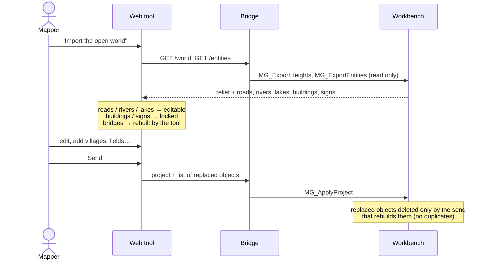
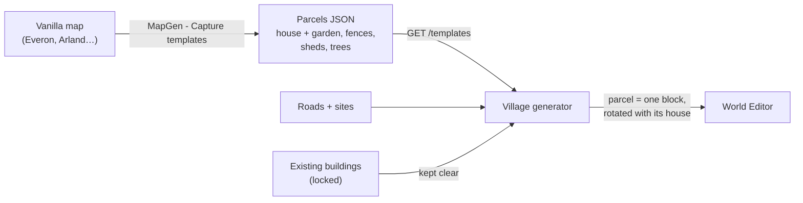

# Reforger Mapper

> Reforger Mapper is an unofficial, work-in-progress web tool (Vite + TypeScript) to quickly design Arma Reforger terrains: generate an island, sculpt the heightmap, paint surface masks, lay out roads, rivers, lakes and bridges, then send everything to the Enfusion Workbench through a small local bridge and a Workbench plugin (`MapGen` menu). Vanilla assets only. MIT licensed. The UI is in English and French (toggle in the top bar); the documentation is in English.

Web tool to map quickly for **Arma Reforger** (Enfusion engine) and auto-fill a map with vanilla assets, then send it to the Workbench World Editor.

### What it is — and what it is not

**It does not replace the Workbench.** The World Editor is a great mapping tool and the place where a map is really finished: detailing, lighting, gameplay, polish. Reforger Mapper does not try to redo it.

**It is a planning and teamwork layer on top of it**, to:

- 🎯 **Focus the work**: rough out the big picture fast (relief, road network, rivers, lakes, where villages and fields go) and let generators do the repetitive filling, so mappers spend their Workbench time on what matters.
- 👥 **Build a map with several people**: a shared, lightweight view of the map that anyone can open, draw on and discuss, without each person needing the whole project in the Workbench. *(Online collaborative mode: on the roadmap.)*
- 🔁 **Go back and forth**: import a world in progress from the Workbench, change the plan, send it back — the Workbench stays the source of truth.

  
  

Left: a generated island with its simulated rivers. Right: a world in progress imported from the Workbench, its roads, rivers, lakes and buildings ready to edit.

## At a glance

```mermaid
flowchart LR
    subgraph WEB["🌐 Web tool (browser)"]
        direction TB
        T[Terrain<br/>generate · sculpt]
        R[Roads<br/>network · signs · barriers]
        W[Water<br/>rivers · lakes · bridges]
        V[Villages<br/>captured parcels]
        F[Fields<br/>Voronoi plots]
    end
    B["🔌 Local bridge<br/>Node · port 5780"]
    subgraph WB["🛠️ Enfusion Workbench"]
        direction TB
        P["MapGen plugin<br/>NET API · port 5775"]
        WE[World Editor<br/>shapes · generators · prefabs]
    end
    WEB -- "send project (JSON)" --> B
    B -- "MG_ApplyProject" --> P
    P --> WE
    WE -. "import: relief, roads,<br/>rivers, lakes, buildings" .-> P
    P -. "MG_ExportHeights<br/>MG_ExportEntities" .-> B
    B -. "GET /world · /entities" .-> WEB
```

## Features

| | Feature | Status |
|---|---|---|
| 🏝️ | **Island generation**: procedural heightmap (noise, island shape), heightmap export | ✅ |
| ⛰️ | **Sculpt**: interactive terrain brush (approach inspired by mapgen4) | ✅ |
| 🎨 | **Surfaces and masks**: surface masks from altitude, slope… + satellite image | ✅ |
| 🛣️ | **Roads**: drawing, road network (graph), furniture and signs along roads | ✅ |
| 🌊 | **Water**: rivers (flow accumulation), lakes, banks | ⚠️ placement not right yet |
| 🌉 | **Bridges** at road / river crossings | ⚠️ placement to fix |
| ⚡ | **Power lines**: pylons and poles linking villages | ⬛ to do |
| 🏘️ | **Villages** built from house + garden parcels captured on the vanilla maps | 🧪 testing |
| 🌾 | **Countryside**: farm plots (Voronoi, inspired by AgriFieldGenerator) | ✅ |
| 📥 | **Import a world in progress**: relief, roads, rivers, lakes become editable; buildings and signs stay locked | 🧪 testing |
| 📊 | **Entity budget**: entities per cell vs platform limit, terrain occlusion, duplicates and buried objects | ✅ limits provisional |
| 📤 | **Send to the Workbench**: shapes, generators and vanilla prefabs, on their own layers | ✅ |

### Round trip with a world in progress

### Village generation from captured parcels

Main modules: `src/modules/` (`island`, `sculpt`, `roads`, `network`, `hydro`, `water`, `campaign`), `src/terrain.ts`, `src/project.ts`, `src/bridge.ts`.

## How it works

1. **Site**: `npm install` then `npm run dev` → http://localhost:5173
2. **Local bridge**: `npm run bridge` (Node, port **5780**), which links the site to the Workbench.
3. **Workbench plugin**: copy `workbench/Mapgenerator/` as an addon into
   `Documents/My Games/ArmaReforgerWorkbench/addons/`, then add it in the Workbench.
4. **Enable the Workbench NET API**: Workbench > Options, NET API enabled (port **5775**). The bridge talks to the
   plugin's own handlers (`MG_*`); nothing else is needed (no AI tool, no MCP server).

   The plugins appear in the World Editor **MapGen** menu:
   - `MapGen - Apply project`: applies the project sent by the site
   - `MapGen - Apply heightmap`
   - `MapGen - Labels`: debug labels
   - `MapGen - Entity budget`: entity count per cell, terrain occlusion, suspects (duplicates, buried objects)
   - `MapGen - Capture templates`: captures building parcels (house + garden) from any world, for the village generator
   - `MapGen - Measure prefabs`
   - `MapGen - Regenerate MG_ shapes`
   - `MapGen - Register surfaces`
   - `MapGen - Stamp calibration`, `MapGen - Terrain probe`, `MapGen - Create test shapes`,
     `MapGen - Terrain write test` / `test 2` (diagnostic tools)

## Documentation (`docs/`)

| File | Content |
|---|---|
| [ARCHITECTURE.md](docs/ARCHITECTURE.md) | Architecture: a single tool, three layers, modules sharing one project |
| [ROADMAP.md](docs/ROADMAP.md) | Roadmap and tech stack |
| [RESEARCH.md](docs/RESEARCH.md) | Research file (BARNMAP, Map-generator, mapgen4, AgriFieldGenerator…) |
| [STATE_OF_ART.md](docs/STATE_OF_ART.md) | State of the art of terrain generation / auto-fill (engines, tools, data, libs) |
| [CITIES.md](docs/CITIES.md) | Village and town generation: state of the art and proposed pipeline |
| [GENERATORS.md](docs/GENERATORS.md) | List of vanilla World Editor generator prefabs (`Prefabs/WEGenerators/`) |
| [ENFUSION_FORMATS.md](docs/ENFUSION_FORMATS.md) | Enfusion formats and API (verified / assumed) |
| [WIKI_TERRAIN.md](docs/WIKI_TERRAIN.md) | Summary of the Bohemia wiki on Reforger terrain creation |
| [WORKSHOP_TERRAIN_MODS.md](docs/WORKSHOP_TERRAIN_MODS.md) | Study of Workshop terrain tooling mods |
| [FINDINGS.md](docs/FINDINGS.md) | Findings and pitfalls (Workbench script, measured prefabs, water, tooling) and remaining work |
| [BENCHMARK_GIORBEV.md](docs/BENCHMARK_GIORBEV.md) | Analysis of giorbev's benchmark tool |
| [FF_ET_SKILLS.md](docs/FF_ET_SKILLS.md) | Notes reused from Reforger / Freedom Fighters modding |

## Status and roadmap

**Work in progress** — the goal is a real mapping assistant next to the Workbench (not a replacement), and later an online space where several mappers plan the same map together.

🟩 done · 🟨 in progress · ⬛ to do

### Known issues / not finished

- 🌉 **Bridges**: deck height, length and alignment with the road are often off; some crossings get no bridge or a misplaced one.
- 🌊 **Rivers**: the course and bed do not always sit right in the relief (water floating above or sunk under the banks); banks are still rough.
- 💧 **Lakes**: shore and water level not always matched to the terrain; lake placement needs work.
- ⚡ **Power lines**: no electric network yet (pylons, poles and wires between villages and along roads).
- 🪨 Rocks, 🌲 automatic forests, 🛤️ paths and 🌾 field zones: not generated yet.
- 🧱 Ground surfaces are not imported from an existing world (relief only).
- 📊 Entity budget limits per platform are provisional (no measured FPS data yet).

Help is welcome on: bridge, river and lake placement, power lines, riverbank / lake shore generation, rocks on steep slopes, automatic forests, paths and field zones, ground surface import, and FPS bench data per platform (Xbox Series S/X, PS5, PC) to calibrate the entity budget.

- **Vanilla assets** only: no third-party content is required or redistributed.
- **No AI tool required**: the site, the bridge and the plugin are all you need.
- Sources, inspirations and licences: see [CREDITS.md](CREDITS.md).

## Thanks, credits and sources

This project stands on the work of many people — thank you to all of them. Full list with notes: [CREDITS.md](CREDITS.md).

### Projects that inspired us / ported code

| Project | Author | URL | Licence | What we reused |
|---|---|---|---|---|
| BARNMAP (v1.48) | Barnaber / LEBARNABER | https://ustorie.github.io/BARNARMA/ | None (closed exe) | Observed behaviour and `.et` formats, data sources; no code. **Use authorised by the author.** |
| Map-generator ("Map Generator Pro" v7) | giorbev | repo `giorbev/Map-generator` | MIT (© 2026 Giorbev) | Surface mask algorithms (slope, TPI, curvature, flow, JSON biomes) ported / to port; binary format documentation (specs). **Use authorised by the author.** |
| mapgen4 | Amit Patel (Red Blob Games) | https://github.com/redblobgames/mapgen4 | Apache-2.0 | Approach reused in `hydro.ts` and `sculpt.ts` (rivers by flow accumulation, terrain brush). Merging Map-generator / BARNMAP / mapgen4 is done with the authors' permission. |
| AgriFieldGenerator (v1.2.0) | Tanin69 (Didier ALAIN) | repo `Tanin69/AgriFieldGenerator` | MIT (© 2024) | Plot pipeline (Voronoi, Bézier, colouring) reimplemented in `campaign.ts`; "Painting with masks" tutorial |
| Benchmark_Tools_reforger | giorbev | — | None (© 2025, all rights reserved) | Measurement ideas and per-platform thresholds; no code |
| Lou's tools (`SCR_WorldEditorToolHelper.c`, `SCR_ImageHelper.c`) | Lou | — | not specified | Idea of an entity density heatmap |
| Azgaar Fantasy Map Generator | Azgaar | https://github.com/Azgaar/Fantasy-Map-Generator | MIT | Idea: habitability score to place settlements |
| ProbableTrain MapGenerator | ProbableTrain | https://maps.probabletrain.com/ | LGPL-3.0 (to confirm) | Ideas (tensor fields for streets) |
| Medieval Fantasy City Generator / TownGeneratorOS | watabou | — | GPL-3.0 (old Haxe version) / closed | Ideas only |
| city-roads | anvaka | — | MIT | Ideas |
| Fantasy Town Generator | — | https://www.fantasytowngenerator.com/temporary-settlement | closed | Ideas |
| FantasyGen City Map Generator | — | https://fantasygen.net/city-map-generator | closed | Ideas |
| Simteract City Generator | Simteract | https://simteract.com/projects/city-generator/ | closed | Ideas |
| Mapimator City Roads | Mapimator | https://mapimator.com/tools/city-roads | closed | Ideas |
| Wave Function Collapse | mxgmn | — | MIT (unverified) | Idea |
| ProtonScatter | HungryProton | https://github.com/HungryProton/scatter | — | Idea: stack of placement filters |
| PCGExtendedToolkit | PCGEx | https://github.com/PCGEx/PCGExtendedToolkit | — | Idea: road network as a graph |
| Unreal PCG / Biome Core | Epic Games | https://dev.epicgames.com/documentation/en-us/unreal-engine/procedural-content-generation-pcg-biome-core-and-sample-plugins-overview-guide-in-unreal-engine | proprietary | Idea: data-driven biomes |
| ReforgerSatGenerator | granQ | https://github.com/granQ/ReforgerSatGenerator | — | Reference |
| ARTE (QGIS plugin) | — | https://plugins.qgis.org/plugins/ARTE/ | — | Reference (competing tool) |

#### City builders and games studied (ideas only, CITIES.md §6)

- OpenTTD, town growth: https://github.com/OpenTTD/OpenTTD/blob/master/src/town_cmd.cpp (GPL-2.0), https://wiki.openttd.org/en/Manual/Game%20mechanics
- Micropolis (open-source SimCity): https://github.com/SimHacker/micropolis (GPL-3.0)
- Citybound: https://github.com/citybound/citybound, https://aeplay.org/citybound-devblog (AGPL-3.0)
- Cities: Skylines: https://skylines.paradoxwikis.com/Zoning, https://skylines.paradoxwikis.com/Districts
- Manor Lords: https://wiki.hoodedhorse.com/Manor_Lords/Building ; Banished
- Minecraft ("jigsaw" villages): https://minecraft.wiki/w/Village, https://minecraft.wiki/w/Jigsaw_Block
- Townscaper (Oskar Stålberg): https://www.gamedeveloper.com/design/how-townscaper-works-a-story-four-games-in-the-making

### Scientific papers

- Parish & Müller (2001), "Procedural Modeling of Cities", SIGGRAPH: street generation.
- Chen, Esch, Wonka, Müller, Zhang (2008), "Interactive Procedural Street Modeling": tensor fields.
- Vanegas et al.: lot subdivision.
- Emilien et al. (2012), "Procedural generation of villages on arbitrary terrains", The Visual Computer: https://hal.inria.fr/hal-00694525
- Zevenbergen & Thorne: terrain curvature (via Map-generator).

Published algorithms, freely reimplemented; no code copied.

### Tools and sites

- Gaea (QuadSpinner): https://quadspinner.com/Order/ (idea: erosion masks)
- World Machine: https://www.cgchannel.com/?p=122990 (idea: tiling with margins)
- World Creator: https://www.world-creator.com/en/buy.phtml
- Houdini (SideFX): https://www.sidefx.com/faq/question/houdini-engine-plugin-free-for-unity-and-unreal/
- Instant Terra, L3DT, Blender-OSM / Blosm, terrain.party
- PCG UE5.6/5.7 (80.lv): https://80.lv/articles/what-s-new-in-pcg-in-ue5-6-ue5-7
- Godot assets (https://godotengine.org/asset-library/asset/edit/14377, https://godotengine.org/asset-library/asset/edit/8541), Fab asset (https://www.fab.com/listings/013f192b-caf4-422f-b560-5166f8c6d9b8), video https://www.youtube.com/watch?v=UmUs9W4riPs: ideas

#### Libraries used

`@turf/turf` (MIT), `maplibre-gl` (BSD-3-Clause), `poisson-disk-sampling` (MIT), `simplex-noise` (MIT), Vite (MIT), TypeScript (Apache-2.0).

### Workshop mods studied

Read for ideas (excerpts of at most 10 lines quoted in the docs, no code copied). **No licence or author stated.**

- AdvancedTerrainTools (`6874E07B40C6D5E5`)
- OutsideTerrainCore (`61F0D506562D9BC9`) / Outside Terrain Tool: https://reforger.armaplatform.com/workshop/61F2B96F0D3F27D4
- TerrainAutomationTools (`684876344DA83476`)
- BARNMAP OMAHA sample map (`6A84C9A969207F9F`)
- Freedom Fighters (conventions and skills, see FF_ET_SKILLS.md)

### Data sources (DEM, OSM…)

| Data | URL | Licence |
|---|---|---|
| OpenStreetMap / Overpass | — | ODbL (attribution + share-alike) |
| ESA WorldCover 10 m | https://registry.opendata.aws/esa-worldcover-vito/ | CC BY 4.0 |
| Copernicus DEM GLO-30 (© DLR / Airbus) | https://registry.opendata.aws/copernicus-dem/ | Copernicus licence, attribution required |
| Mapterhorn | https://mapterhorn.com/data-access/ | Per source: https://download.mapterhorn.com/attribution.json |
| IGN LiDAR HD (DTM) | https://www.data.gouv.fr/datasets/mnt-lidar-hd-ign-2025 | Licence Ouverte Etalab 2.0 (to confirm) |
| Mapzen / Tilezen (Terrarium), Esri World Imagery, CARTO basemap | — | Seen in BARNMAP |

### Bohemia Interactive tools

- Arma Reforger Tools / Enfusion Workbench, World Editor, Terrain Creation Tool: https://community.bistudio.com/wiki/Arma_Reforger:World_Editor:_Terrain_Creation_Tool
- Bohemia wiki (BIKI): https://community.bistudio.com/wiki/ (read via the offline dump shipped with enfusion-mcp)
- Terrain Builder / Terrain Processor (Arma 3): https://community.bistudio.com/wiki/Terrain_Processor:_Tutorial
- Official terrain tutorial: https://reforger.armaplatform.com/news/terrain-tutorial
- Vanilla generator prefabs (`Prefabs/WEGenerators/`) and vanilla game assets

Arma Reforger and Enfusion are trademarks of Bohemia Interactive. Unofficial fan tool.

### Other

- **enfusion-mcp**: MCP server used to explore the API, the game files and the wiki.
- Development assisted by **Claude (Anthropic)**.

## Licence and notices

Code under the [MIT](LICENSE) licence.

*Arma Reforger* and *Enfusion* are trademarks of **Bohemia Interactive**. Reforger Mapper is an **unofficial fan tool**, not affiliated with or endorsed by Bohemia Interactive.
