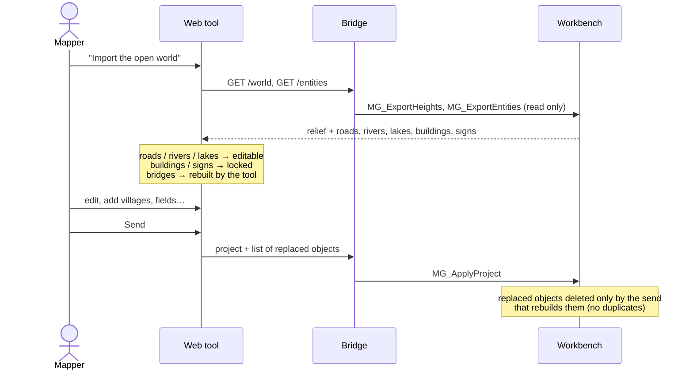
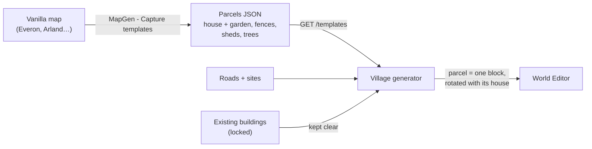

# Reforger Mapper

> Reforger Mapper is an unofficial, work-in-progress web tool (Vite + TypeScript) to quickly design Arma Reforger terrains: generate an island, sculpt the heightmap, paint surface masks, lay out roads, rivers, lakes and bridges, then send everything to the Enfusion Workbench through a small local bridge and a Workbench plugin (`MapGen` menu). Vanilla assets only. MIT licensed. The UI is in English and French (toggle in the top bar); the documentation is in English.

Web tool to map quickly for **Arma Reforger** (Enfusion engine) and auto-fill a map with vanilla assets, then send it to the Workbench World Editor.

  
  

Left: a generated island with its simulated rivers. Right: a world in progress imported from the Workbench, its roads, rivers, lakes and buildings ready to edit.

## At a glance

```mermaid
flowchart LR
    subgraph WEB["🌐 Web tool (browser)"]
        direction TB
        T[Terrain<br/>generate · sculpt]
        R[Roads<br/>network · signs · barriers]
        W[Water<br/>rivers · lakes · bridges]
        V[Villages<br/>captured parcels]
        F[Fields<br/>Voronoi plots]
    end
    B["🔌 Local bridge<br/>Node · port 5780"]
    subgraph WB["🛠️ Enfusion Workbench"]
        direction TB
        P["MapGen plugin<br/>NET API · port 5775"]
        WE[World Editor<br/>shapes · generators · prefabs]
    end
    WEB -- "send project (JSON)" --> B
    B -- "MG_ApplyProject" --> P
    P --> WE
    WE -. "import: relief, roads,<br/>rivers, lakes, buildings" .-> P
    P -. "MG_ExportHeights<br/>MG_ExportEntities" .-> B
    B -. "GET /world · /entities" .-> WEB
```

## Features

| | Feature | Status |
|---|---|---|
| 🏝️ | **Island generation**: procedural heightmap (noise, island shape), heightmap export | ✅ |
| ⛰️ | **Sculpt**: interactive terrain brush (approach inspired by mapgen4) | ✅ |
| 🎨 | **Surfaces and masks**: surface masks from altitude, slope… + satellite image | ✅ |
| 🛣️ | **Roads**: drawing, road network (graph), furniture and signs along roads | ✅ |
| 🌊 | **Water**: rivers (flow accumulation), lakes, banks | ✅ banks still rough |
| 🌉 | **Bridges** at road / river crossings | ✅ |
| 🏘️ | **Villages** built from house + garden parcels captured on the vanilla maps | 🧪 testing |
| 🌾 | **Countryside**: farm plots (Voronoi, inspired by AgriFieldGenerator) | ✅ |
| 📥 | **Import a world in progress**: relief, roads, rivers, lakes become editable; buildings and signs stay locked | 🧪 testing |
| 📊 | **Entity budget**: entities per cell vs platform limit, terrain occlusion, duplicates and buried objects | ✅ limits provisional |
| 📤 | **Send to the Workbench**: shapes, generators and vanilla prefabs, on their own layers | ✅ |

### Round trip with a world in progress

### Village generation from captured parcels

Main modules: `src/modules/` (`island`, `sculpt`, `roads`, `network`, `hydro`, `water`, `campaign`), `src/terrain.ts`, `src/project.ts`, `src/bridge.ts`.

## How it works

1. **Site**: `npm install` then `npm run dev` → http://localhost:5173
2. **Local bridge**: `npm run bridge` (Node, port **5780**), which links the site to the Workbench.
3. **Workbench plugin**: copy `workbench/Mapgenerator/` as an addon into
   `Documents/My Games/ArmaReforgerWorkbench/addons/`, then add it in the Workbench.
4. **Enable the Workbench NET API**: Workbench > Options, NET API enabled (port **5775**). The bridge talks to the
   plugin's own handlers (`MG_*`); nothing else is needed (no AI tool, no MCP server).

   The plugins appear in the World Editor **MapGen** menu:
   - `MapGen - Apply project`: applies the project sent by the site
   - `MapGen - Apply heightmap`
   - `MapGen - Labels`: debug labels
   - `MapGen - Entity budget`: entity count per cell, terrain occlusion, suspects (duplicates, buried objects)
   - `MapGen - Capture templates`: captures building parcels (house + garden) from any world, for the village generator
   - `MapGen - Measure prefabs`
   - `MapGen - Regenerate MG_ shapes`
   - `MapGen - Register surfaces`
   - `MapGen - Stamp calibration`, `MapGen - Terrain probe`, `MapGen - Create test shapes`,
     `MapGen - Terrain write test` / `test 2` (diagnostic tools)

## Documentation (`docs/`)

| File | Content |
|---|---|
| [ARCHITECTURE.md](docs/ARCHITECTURE.md) | Architecture: a single tool, three layers, modules sharing one project |
| [ROADMAP.md](docs/ROADMAP.md) | Roadmap and tech stack |
| [RESEARCH.md](docs/RESEARCH.md) | Research file (BARNMAP, Map-generator, mapgen4, AgriFieldGenerator…) |
| [STATE_OF_ART.md](docs/STATE_OF_ART.md) | State of the art of terrain generation / auto-fill (engines, tools, data, libs) |
| [CITIES.md](docs/CITIES.md) | Village and town generation: state of the art and proposed pipeline |
| [GENERATORS.md](docs/GENERATORS.md) | List of vanilla World Editor generator prefabs (`Prefabs/WEGenerators/`) |
| [ENFUSION_FORMATS.md](docs/ENFUSION_FORMATS.md) | Enfusion formats and API (verified / assumed) |
| [WIKI_TERRAIN.md](docs/WIKI_TERRAIN.md) | Summary of the Bohemia wiki on Reforger terrain creation |
| [WORKSHOP_TERRAIN_MODS.md](docs/WORKSHOP_TERRAIN_MODS.md) | Study of Workshop terrain tooling mods |
| [FINDINGS.md](docs/FINDINGS.md) | Findings and pitfalls (Workbench script, measured prefabs, water, tooling) and remaining work |
| [BENCHMARK_GIORBEV.md](docs/BENCHMARK_GIORBEV.md) | Analysis of giorbev's benchmark tool |
| [FF_ET_SKILLS.md](docs/FF_ET_SKILLS.md) | Notes reused from Reforger / Freedom Fighters modding |

## Status and roadmap

**Work in progress** — the goal is a real mapping assistant, and later an online, collaborative one.

```mermaid
flowchart LR
    classDef done fill:#2e7d32,color:#fff,stroke:#1b5e20
    classDef wip fill:#f9a825,color:#000,stroke:#f57f17
    classDef todo fill:#455a64,color:#fff,stroke:#263238
    A[Terrain · roads · water · bridges]:::done --> B[World import + editing]:::wip
    B --> C[Villages from captured parcels]:::wip
    C --> D[Banks · rocks · forests · paths · fields]:::todo
    D --> E[Ground surfaces import]:::todo
    E --> F[Online site + SHP/CSV export]:::todo
    F --> G[Real-time collaboration]:::todo
```

🟩 done · 🟨 in progress · ⬛ to do

Help is welcome on: riverbank / lake shore generation, rocks on steep slopes, automatic forests, paths and field zones, ground surface import, and FPS bench data per platform (Xbox Series S/X, PS5, PC) to calibrate the entity budget.

- **Vanilla assets** only: no third-party content is required or redistributed.
- **No AI tool required**: the site, the bridge and the plugin are all you need.
- Sources, inspirations and licences: see [CREDITS.md](CREDITS.md).

## Licence and notices

Code under the [MIT](LICENSE) licence.

*Arma Reforger* and *Enfusion* are trademarks of **Bohemia Interactive**. Reforger Mapper is an **unofficial fan tool**, not affiliated with or endorsed by Bohemia Interactive.
